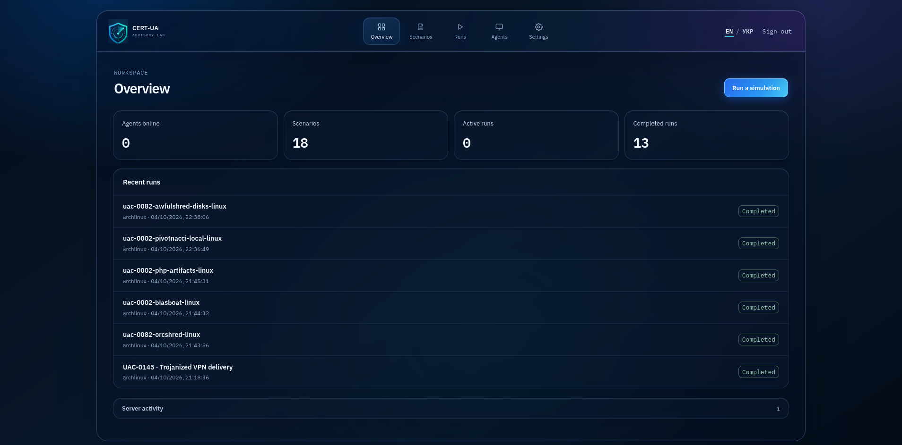
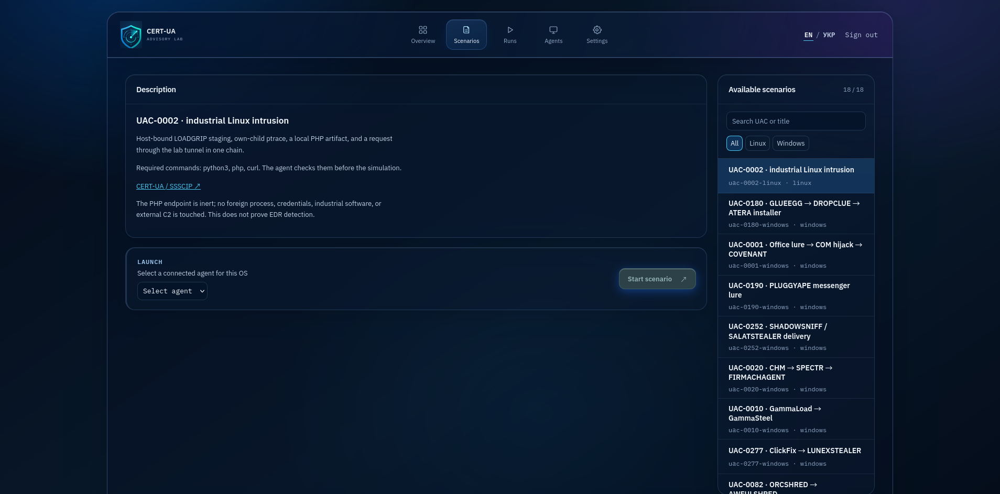
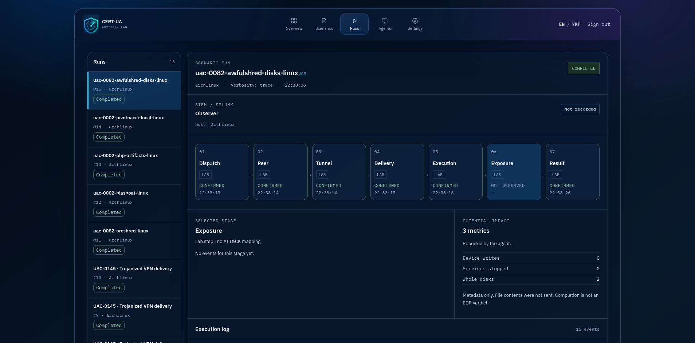
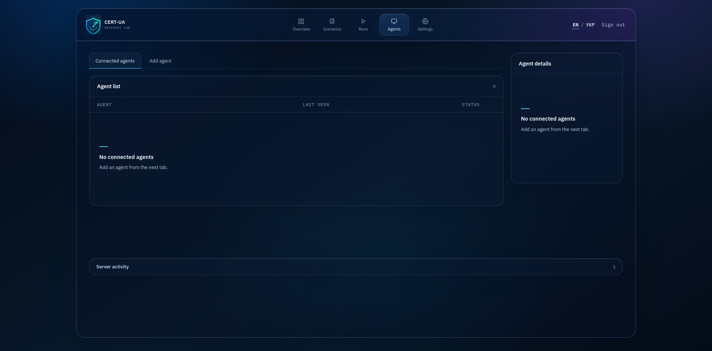
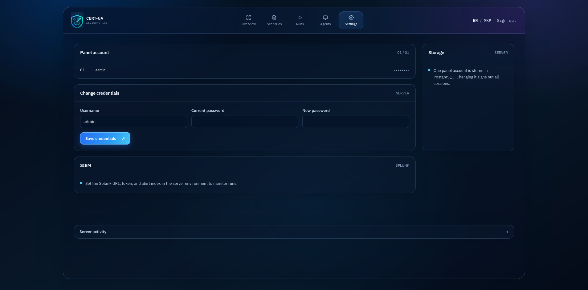

# CERT-UA Advisory Lab

CERT-UA Advisory Lab runs bounded security simulations on a host you control. Choose a scenario, enroll a Linux or Windows agent, run the lab chain, and compare its events with your EDR or SIEM alerts. The panel records what the agent did and when; it does not treat a completed run as a detection verdict.

The catalog currently covers [18 scenarios from 18 CERT-UA UAC clusters](panel/modules/coverage.json). Each scenario links to its source report and explains which actions are simulated. The [selection register](panel/modules/SELECTION.md) records why each cluster was included.

## Install on a VPS

The installer supports a fresh Debian or Ubuntu VPS on amd64 or arm64. You need sudo access and Git read access to this repository. It installs PostgreSQL, builds the panel, and starts the `certua-panel` systemd service.

1. Clone the repository and start the installer:

   ```sh
   git clone git@github.com:dencent444/certua-advisory-lab.git
   cd certua-advisory-lab
   sudo ./install.sh
   ```

2. Set the first panel password when prompted. The installer creates one administrator account. Keep the admin listener private: it binds to `127.0.0.1:4180` and is not exposed through the agent tunnel.

3. On your operator machine, forward the admin port over SSH:

   ```sh
   ssh -L 4180:127.0.0.1:4180 <ssh-user>@<vps-host>
   ```

   Open `http://127.0.0.1:4180/login` and sign in with the account created during installation.

The installer uses TCP `4181` for agents and, by default, UDP `51820` for the private WireGuard module channel. If the agent port is not publicly reachable, the server starts a Pinggy HTTPS tunnel for **agent traffic only**. A direct TCP agent connection uses HTTP, so expose it only on a trusted network. Allow UDP `51820` if you use the WireGuard channel.

For a VPS without public IPv4, install with `sudo PANEL_INSTALL_WIREGUARD=0 ./install.sh`. Set `PANEL_PUBLIC_IP` if automatic address detection is wrong. Run `./install.sh --help` for all installer options. The installer is for a fresh installation and stops if the panel is already installed. It does not edit Nginx, your CDN, other websites, or firewall rules.

## Run a test

1. Choose a test host with the EDR or logging stack you want to evaluate. Record its hostname, sensor, and the planned run time.
2. Open **Agents → Add agent**. Select Linux or Windows and run the displayed command **on the test host**, under the account the scenario should use. Linux installs a systemd user service; Windows installs a scheduled task. The agent remains active after the terminal closes.
3. Confirm the host appears under **Agents**. It sends a heartbeat every 10 seconds and host information once per minute.
4. Open **Scenarios**. Choose a scenario for that operating system and review its source, dependencies, actions, and limits. Select an agent and the log verbosity, then start the simulation.
5. The panel opens **Runs**. Follow the stage graph and execution log, then compare those timestamps and process, file, registry, task, or network signals with your EDR or SIEM. A missing dependency is reported before the scenario actions run.
6. When the test is finished, use **Disconnect** under **Agents**. The agent removes its service or scheduled task on its next heartbeat.

For example, UAC-0212 on Windows creates a local shortcut, starts PowerShell, writes a temporary `Run` value, and copies a module-owned sample document. It does not read the host's documents. A matching EDR alert must be checked in the EDR or SIEM itself.

### Reading the result

| Panel result | Meaning |
| --- | --- |
| Confirmed stage | The agent or server reported that lab step. |
| Missing dependency | The scenario stopped before its actions ran. |
| SIEM alert found | An alert matched the host and run window; verify its rule and source event. |
| No SIEM alert found | A successful alert search found no match after the observation window. Check telemetry ingestion and detection rules. |
| Completed run | The lab chain returned a result. This is not an EDR verdict. |

Splunk alert monitoring is optional. The [SIEM setup guide](panel/README.md#siem-observer-splunk) covers its URL, API token, alert index, and host-field mapping.

## Install on a workstation

For a non-VPS installation, install PostgreSQL, Node.js 20.19+ or 22.12+, npm, a C++20 compiler, OpenSSH, libcurl, OpenSSL, the `nlohmann/json` headers, and the `libpq.so.5` runtime library. Create a PostgreSQL role and database:

```sql
CREATE ROLE certua_panel LOGIN PASSWORD '<database-password>';
CREATE DATABASE certua_panel OWNER certua_panel;
```

Clone the repository and start the panel from its top-level directory:

```sh
git clone git@github.com:dencent444/certua-advisory-lab.git
cd certua-advisory-lab
PANEL_DATABASE_URL='host=127.0.0.1 dbname=certua_panel user=certua_panel password=<database-password>' \
PANEL_BOOTSTRAP_USER=admin \
PANEL_BOOTSTRAP_PASSWORD='<at least 16 characters>' \
./panel/run 4173
```

Open `http://127.0.0.1:4173/login`. Bootstrap credentials create the administrator account only on the first run; later starts need `PANEL_DATABASE_URL`. The launcher builds the frontend and server. Its agent port is `4174` in this example; `PANEL_AGENT_PORT` changes it.

## Components and modules

| Component | Responsibility |
| --- | --- |
| React, TypeScript, Vite | English and Ukrainian admin panel |
| C++20 server, PostgreSQL | Authentication, agent enrollment, tasks, results, and logs |
| Linux and Windows agents | Pull signed tasks and report host status |
| `panel/modules/` | One directory per UAC scenario and operating system |

Each module has a `manifest.json` and a platform script (`run.sh` or `run.ps1`). The manifest lists the CERT-UA source, prerequisites, actions, limits, and MITRE ATT&CK mappings. The [porting pipeline](panel/modules/PIPELINE.md) explains how to add a module; [panel/README.md](panel/README.md) covers the agent protocol, WireGuard, and Splunk configuration.

## Interface demo

The panel supports English and Ukrainian. These screenshots show a populated test installation.

<details>
<summary>Overview</summary>



</details>

<details>
<summary>Scenarios</summary>



</details>

<details>
<summary>Runs</summary>



</details>

<details>
<summary>Agents</summary>



</details>

<details>
<summary>Settings</summary>



</details>

## Development

React pages and forms are in `panel/src/`; shared API types are in `models.ts`, and run-stage labels and definitions are in `attackMapData.ts`. The C++ server routes requests in `handle_client` and delegates agent, admin, and task operations to separate handlers.

After a change, run these checks from `panel/`:

```sh
npm run format:check
npm run build
clang-format --dry-run --Werror server/main.cpp server/postgres.hpp
g++ -std=c++20 -O2 -Wall -Wextra -pthread server/main.cpp -lcurl -lcrypto -ldl -o build/panel-server
python3 modules/validate.py
```

Run `npm run format` and `clang-format -i server/main.cpp server/postgres.hpp` to apply the configured styles. For module checks, use `python3 panel/modules/validate.py --run` from the top-level directory. Windows runtime tests require a Windows agent.

## Use responsibly

Run simulations only on systems you own or are authorized to test. Modules execute with the test user's permissions. A completed run confirms the lab actions, not that the original malware was reproduced or that a defender detected it.
